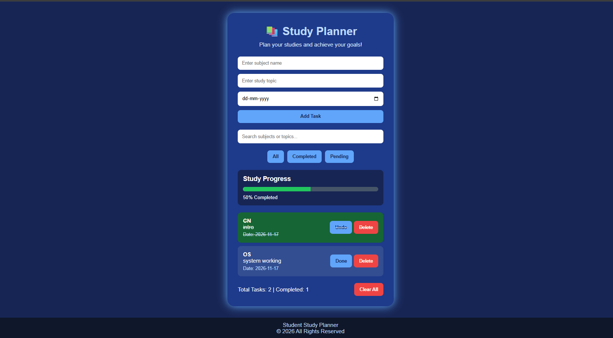

# Ex03 To-Do List using JavaScript
## Date: 17/11/2026

## AIM
To create a To-do Application with all features using JavaScript.

## ALGORITHM
### STEP 1
Build the HTML structure (index.html).

### STEP 2
Style the App (style.css).

### STEP 3
Plan the features the To-Do App should have.

### STEP 4
Create a To-do application using Javascript.

### STEP 5
Add functionalities.

### STEP 6
Test the App.

### STEP 7
Open the HTML file in a browser to check layout and functionality.

### STEP 8
Fix styling issues and refine content placement.

### STEP 9
Deploy the website.

### STEP 10
Upload to GitHub Pages for free hosting.

## PROGRAM
```
<!-- index.html -->

<!DOCTYPE html>
<html lang="en">
<head>
    <meta charset="UTF-8">
    <meta name="viewport" content="width=device-width, initial-scale=1.0">

    <title>Student Study Planner</title>

    <link rel="stylesheet" href="sty.css">
</head>

<body>

    <div class="planner">

        <h1>📚 Study Planner</h1>

        <p class="subtitle">
            Plan your studies and achieve your goals!
        </p>

        <div class="input-area">

            <input type="text" id="subject"
            placeholder="Enter subject name">

            <input type="text" id="topic"
            placeholder="Enter study topic">

            <input type="date" id="studyDate">

            <button onclick="addStudy()">Add Task</button>

        </div>

        <div class="search-box">
            <input type="text" id="search"
            placeholder="Search subjects or topics..."
            oninput="displayStudies()">
        </div>

        <div class="filters">

            <button onclick="setFilter('all')">All</button>

            <button onclick="setFilter('completed')">
                Completed
            </button>

            <button onclick="setFilter('pending')">
                Pending
            </button>

        </div>

        <div class="progress-box">

            <h3>Study Progress</h3>

            <div class="progress">
                <div id="progressBar"></div>
            </div>

            <p id="progressText">0% Completed</p>

        </div>

        <ul id="studyList"></ul>

        <div class="status">

            <span id="count">Total Tasks: 0</span>

            <button class="clear" onclick="clearStudies()">
                Clear All
            </button>

        </div>

    </div>

    <footer>
        <p>Student Study Planner</p>
        <p>© 2026 All Rights Reserved</p>
    </footer>

    <script src="scri.js"></script>

</body>
</html>
<!-- style.css -->

* {
    margin: 0;
    padding: 0;
    box-sizing: border-box;
    font-family: Arial, sans-serif;
}

body {
    min-height: 100vh;
    background: #172554;
    display: flex;
    justify-content: center;
    align-items: center;
    flex-direction: column;
    padding: 30px 15px 90px;
    color: white;
}

.planner {
    width: 480px;
    max-width: 100%;
    background: #1e3a8a;
    padding: 30px;
    border-radius: 20px;
    box-shadow: 0 0 25px #60a5fa;
}

h1 {
    text-align: center;
    color: #bfdbfe;
    margin-bottom: 10px;
}

.subtitle {
    text-align: center;
    color: #dbeafe;
    margin-bottom: 25px;
}

.input-area {
    display: flex;
    flex-direction: column;
    gap: 12px;
}

input {
    width: 100%;
    padding: 12px;
    border: none;
    border-radius: 8px;
    outline: none;
}

button {
    padding: 11px 15px;
    background: #60a5fa;
    color: #172554;
    border: none;
    border-radius: 8px;
    font-weight: bold;
    cursor: pointer;
}

button:hover {
    background: #bfdbfe;
}

.search-box {
    margin-top: 20px;
}

.filters {
    display: flex;
    justify-content: center;
    gap: 10px;
    margin: 20px 0;
}

.progress-box {
    background: #172554;
    padding: 15px;
    border-radius: 10px;
    margin-bottom: 20px;
}

.progress-box h3 {
    margin-bottom: 12px;
}

.progress {
    width: 100%;
    height: 12px;
    background: #475569;
    border-radius: 10px;
    overflow: hidden;
}

#progressBar {
    width: 0%;
    height: 100%;
    background: #22c55e;
    transition: width 0.3s;
}

#progressText {
    margin-top: 10px;
    font-size: 14px;
}

ul {
    list-style: none;
}

li {
    background: #334e91;
    padding: 15px;
    margin: 10px 0;
    border-radius: 10px;
    display: flex;
    justify-content: space-between;
    align-items: center;
    gap: 10px;
}

.study-info {
    flex: 1;
    overflow-wrap: anywhere;
}

.study-info small {
    display: block;
    margin-top: 6px;
    color: #bfdbfe;
}

.completed {
    background: #166534;
    text-decoration: line-through;
}

.actions {
    display: flex;
    gap: 5px;
}

.delete {
    background: #ef4444;
    color: white;
}

.status {
    display: flex;
    justify-content: space-between;
    align-items: center;
    margin-top: 20px;
    gap: 10px;
}

.clear {
    background: #ef4444;
    color: white;
}

footer {
    position: fixed;
    bottom: 0;
    width: 100%;
    background: #0f172a;
    text-align: center;
    padding: 12px;
    color: #bfdbfe;
}

@media(max-width: 500px) {
    .planner {
        padding: 20px;
    }

    h1 {
        font-size: 23px;
    }

    .filters {
        gap: 5px;
    }

    .filters button {
        padding: 9px;
    }
}
<!-- script.js -->

let studies = JSON.parse(
    localStorage.getItem("studyTasks")
) || [];

let currentFilter = "all";

displayStudies();

// Add Study Task

function addStudy() {

    let subject = document.getElementById("subject").value.trim();

    let topic = document.getElementById("topic").value.trim();

    let date = document.getElementById("studyDate").value;

    if (subject === "" || topic === "" || date === "") {

        alert("Please fill all the fields!");

        return;
    }

    let study = {

        id: Date.now(),

        subject: subject,

        topic: topic,

        date: date,

        completed: false

    };

    studies.push(study);

    saveStudies();

    document.getElementById("subject").value = "";

    document.getElementById("topic").value = "";

    document.getElementById("studyDate").value = "";

    displayStudies();

}

// Display Study Tasks

function displayStudies() {

    let list = document.getElementById("studyList");

    let search = document.getElementById("search")
        .value.toLowerCase();

    list.innerHTML = "";

    let filtered = studies.filter(study => {

        let matchesFilter =
            currentFilter === "all" ||
            (currentFilter === "completed" && study.completed) ||
            (currentFilter === "pending" && !study.completed);

        let matchesSearch =
            study.subject.toLowerCase().includes(search) ||
            study.topic.toLowerCase().includes(search);

        return matchesFilter && matchesSearch;

    });

    filtered.forEach(study => {

        let li = document.createElement("li");

        if (study.completed) {
            li.classList.add("completed");
        }

        let info = document.createElement("div");

        info.className = "study-info";

        let heading = document.createElement("strong");

        heading.textContent = study.subject;

        let topic = document.createElement("p");

        topic.textContent = study.topic;

        let date = document.createElement("small");

        date.textContent = "Date: " + study.date;

        info.appendChild(heading);

        info.appendChild(topic);

        info.appendChild(date);

        let actions = document.createElement("div");

        actions.className = "actions";

        let doneBtn = document.createElement("button");

        doneBtn.textContent = study.completed ? "Undo" : "Done";

        doneBtn.onclick = () => completeStudy(study.id);

        let deleteBtn = document.createElement("button");

        deleteBtn.textContent = "Delete";

        deleteBtn.className = "delete";

        deleteBtn.onclick = () => deleteStudy(study.id);

        actions.appendChild(doneBtn);

        actions.appendChild(deleteBtn);

        li.appendChild(info);

        li.appendChild(actions);

        list.appendChild(li);

    });

    updateProgress();

}

// Complete Study

function completeStudy(id) {

    studies = studies.map(study => {

        if (study.id === id) {

            study.completed = !study.completed;

        }

        return study;

    });

    saveStudies();

    displayStudies();

}

// Delete Study

function deleteStudy(id) {

    studies = studies.filter(study => study.id !== id);

    saveStudies();

    displayStudies();

}

// Filter Tasks

function setFilter(type) {

    currentFilter = type;

    displayStudies();

}

// Update Progress

function updateProgress() {

    let total = studies.length;

    let completed = studies.filter(
        study => study.completed
    ).length;

    let percentage = total === 0
        ? 0
        : Math.round((completed / total) * 100);

    document.getElementById("progressBar").style.width =
        percentage + "%";

    document.getElementById("progressText").textContent =
        percentage + "% Completed";

    document.getElementById("count").textContent =
        "Total Tasks: " + total +
        " | Completed: " + completed;

}

// Clear All Tasks

function clearStudies() {

    if (studies.length === 0) {
        alert("No study tasks available!");
        return;
    }

    if (confirm("Delete all study tasks?")) {

        studies = [];

        saveStudies();

        displayStudies();

    }

}

// Save Data

function saveStudies() {

    localStorage.setItem(
        "studyTasks",
        JSON.stringify(studies)
    );

}
```

## OUTPUT



## RESULT
The program for creating To-do list using JavaScript is executed successfully.
<!-- website completed -->